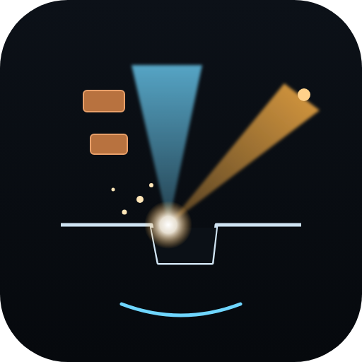

<p align="center"></p>

# Sculpting with Ions

**Live exhibit: https://advanced-em.github.io/FIB-view/**

An interactive dual-beam microscope (FIB-SEM) in the browser, built as a small science-museum exhibit. It is the
sister exhibit of [Seeing with Electrons](https://advanced-em.github.io/TEM-view/) (TEM) and Seeing Surfaces (SEM):
everything the SEM exhibit does, plus a focused ion beam that images, mills, deposits and prepares TEM lamellae.

- **3D cutaway dual beam:** the electron column and an ion column 52° from it, crossing at the coincidence point;
  a gallium liquid-metal ion source or an inductively coupled plasma source (xenon, argon, nitrogen, oxygen, with
  their gas bottles), an aperture strip, gas-injection needles, a lift-out manipulator, the ion detector, and all
  the SEM detectors (ETD, in-lens, 4-quadrant BSE, EDS, EBSD, TKD). Ions travel visibly slower than electrons, and
  sputtered atoms fly off the spot. Click any label for an instrument-physics card.
- **Twelve modes:**
  - *Electron beam:* SE · ETD, in-lens, BSE (selectable quadrants), EBSD and TKD with live Hough indexing, EDS.
  - *Ion beam:* **ion image** (ion-induced secondary electrons or secondary ions), **mill**, **deposit**.
  - *Workflows:* **slice & view** (FIB-SEM tomography) and **lamella** (an eight-step TEM lift-out).
  - *Physics:* Monte Carlo of **electrons** (interaction volume) or **ions** (collision cascades).
- **Ion species:** Ga⁺ (2.5 nm probes, implants and amorphises), Xe⁺ (fast bulk milling, 1.5 pA–2.5 µA),
  Ar⁺ (gentle polishing), N⁺ and O⁺ (light; oxygen burns carbon and polymers several times faster and boosts
  secondary-ion yields). Probe size vs current follows measured columns (source, chromatic and spherical terms,
  with beam tails), and lower voltage enlarges the probe.
- **Imaging with both beams:** images are ray-cast through the current, milled surface, so a 52° SEM view sees
  the face of a cross-section (Pt cap, oxide, copper wiring, tungsten vias, silicon) while the ion view looks into
  the trench from above. Ion images show dramatic **channelling** grain contrast, dark oxides and positively charged
  insulators (switch on the electron flood), and every ion frame **sputters** the specimen: zoom in on tin spheres
  and watch them erode.
- **Milling physics:** sputter yields from measured Ga 30 kV volume yields, scaled to the other species and energies
  with Sigmund's theory and ZBL nuclear stopping, Yamamura's angular dependence, channelling (grain-dependent
  milling), gas chemistry (XeF₂ for Si/SiO₂/W, water for carbon), redeposition in deep, narrow trenches, sloped
  walls and beam tails. Patterns (rectangle, regular cross-section, cleaning cross-section, line, circle) are drawn
  on the ion image and run one after another; their dose comes from a silicon "application file", so other
  materials end up deeper or shallower than asked. Curtaining appears below materials of different yield, reduced
  by a Pt cap and a rocking mill.
- **Gas injection:** Pt, C and W deposition with the ion or the electron beam, with reaction-limited,
  precursor-limited and net-milling regimes vs current density.
- **Ion collision cascades:** a binary-collision Monte Carlo (ZBL potential with a tabulated scattering integral,
  Lindhard–Scharff electronic stopping, full recoil cascades, surface-binding sputtering): Ga 30 keV in Si gives a
  projected range of ~27–30 nm and a yield of ~2, as in SRIM.
- **Slice & view:** a Li-ion cathode (NMC particles with cracks, carbon-binder web, ~30 % pores) or the chip,
  sliced and imaged (BSE or SE), with orthogonal slices, curtains, pore shine-through, and segmented phase
  fractions compared with the truth.
- **Lamella:** e-beam Pt, ion-beam Pt, bulk trenches, cleaning cross-sections, J-cut, lift-out, thinning at
  currents you choose (with over-tilt), and 5/2 kV polishing. The true thickness wedge, amorphous damage, Ga
  content, bending and holes are tracked; a 5 kV SEM view of the face shows the thickness the way an operator sees
  it. Send the finished lamella to TKD.
- **EDS** now sees the implanted beam ions (Ga, Xe, Ar) in milled areas.
- **Experiments:** cross-section a chip, gallium vs xenon vs oxygen on a battery cathode, channelling contrast,
  charging, nanograins (EBSD vs TKD), and a fly-through.

### Everything from the TEM exhibit's infrastructure

- **Console and on-screen panel:** the TEM-view Console (or any game controller) drives the exhibit through the
  Gamepad API; the knobs follow the active beam (focus, magnification, beam current along the aperture strip,
  multifunction: stigmator / beam shift / tilt and stage Z / pattern size, context: voltage, pattern depth,
  deposit thickness, lamella target, slice thickness). Press `V` for the on-screen panel (Q/W focus, A/S
  magnification, Z/X current, H/L and K/J multifunction, O/P context, arrows for the stage, Tab, U to start or stop
  patterning); pop it out to a second screen. The Console is the [TEM-view Console](https://advanced-em.github.io/TEM-view/console/): the same hardware drives both exhibits.
- **Training scenarios with hidden truth and telemetry:** *SEM: focus and stigmate*, *Ion beam: focus without
  destroying it* (scored on sharpness and on the material your imaging removed), *Dual beam: find the eucentric
  height* (the stage Z reading is offset), and *Lamella: thin to 100 nm* (the true thickness is hidden). Consent
  first; sessions are recorded as `fib-view-telemetry/1` (no personal data), can be downloaded, replayed with a
  scrubber and the true score over time, analysed with `tools/analysis/sessions.py`, and shared with a Hugging Face
  dataset through [`hf/`](hf/README.md) (a Cloudflare Worker or an HF Space collector, and `hf/build_dataset.py`
  for the `sessions` and `steps` tables). `js/config.js` holds the collector address (empty: local only).
- **AI mode (brain button, `/`):** a command bar and push-to-talk voice (`M`) with a FIB grammar ("switch to
  xenon", "ion current 1 nA", "tilt to 52", "mill a box 10 by 5 by 2 microns", "clean the face", "deposit 1 micron
  of platinum", "slice and view", "next step", "thin to 100 nm", "polish at 5 kV"), spell correction with
  confirmation, and analyses: `measure_resolution`, `measure_mill`, `sputter_yield`, `fit_eds`, `ebsd_stats`,
  `sv_fractions`, `lamella_thickness`, `ion_range`, each compared with the simulator's truth.
- **AI agents:** [`tools/fibview-mcp`](tools/fibview-mcp/README.md) is an MCP server: headless `simulate`, `mill`
  and `ion_physics` tools, and live control of an open exhibit after the visitor clicks *Connect agent*
  (`exhibit_set`, `exhibit_pattern`, `exhibit_command`, `exhibit_acquire`, `exhibit_analyze`, `exhibit_say`,
  `exhibit_wait_for_voice`). It listens on port 8792 so it can run next to TEM-view's temview-mcp (8790).
- **Python:** [`tools/fibview-py`](tools/fibview-py/README.md) scripts the instrument (`fib.set`, `fib.mill`,
  `fib.deposit`, `fib.lamella`, `fib.acquire`, `fib.analyze`, challenges). The same scripts run in the exhibit's
  Python IDE (`P`, Pyodide), headless on a desktop, or driving an open exhibit.
- **Acquire** (`I`): numbered acquisitions in a gallery, each downloadable as PNG or NumPy `.npz` with metadata
  (calibrations, beams, pattern depth maps, lamella truth). **Export** and **save/load sessions** (including the
  milled patterns). **Headless:** `node tools/headless.mjs --mode mill --spec chip --ion Xe --mill rcs:16x8x6`.
- **Guides** ([`docs/guides/`](docs/guides/index.html), linked from the exhibit's header): printable SOPs with figures
  computed by the exhibit. *SOP-01 TEM lamella lift-out* (cap, trenches, cleaning, J-cut, lift-out, thinning with
  over-tilt, 5/2 kV polish, troubleshooting, checklist) and *SOP-02 Python scripting*. Regenerate the figures with
  `node tools/guide-figs.mjs` and the PDFs with `node tools/guides.mjs` (both use Chrome).
- **Narration** (speaker buttons, `N` for auto-narrate) with the browser's speech synthesis, General or Physics
  level, female or male voice. **Educational ↔ realistic** toggle. **Results panel** enlarge (`X`) or pop out.
  **Phones and tablets:** one scrolling page below 1100 px.

## Run

ES modules need to be served over HTTP:

```bash
python3 -m http.server 8768
```

Then open http://localhost:8768. Three.js loads from jsDelivr. Plain static files: GitHub Pages works directly.

### Releasing

```bash
npm test                 # physics references, every mode × specimen, training tasks, grammar
node tools/stamp.mjs     # cache-busting version on every module and the stylesheet in index.html
```

Regenerate the guide figures and PDFs with `node tools/guide-figs.mjs` and `node tools/guides.mjs`, and the icon
set and social-preview banner with `node tools/icons.mjs` (all three use Chrome).

## Controls

Drag the instrument to orbit, scroll to zoom. Keys `1`–`9`, `0`, `-`, `=` switch modes, `Space` pauses, `C`
clarity, `L` labels, `R` resets the view, `N` narration, `X` enlarges the results, `V` on-screen panel, `I`
acquire, `U` start/stop patterning, `T` training, `P` Python, `/` AI mode, hold `M` to talk, `[` `]` fold the side
panels. Drag the image to move the stage (Alt-drag in Mill and Deposit, where a plain drag draws a pattern), scroll
it to zoom. In BSE click the quadrants; in EDS click a peak; in EBSD/TKD hover the map for its pattern.

## Code map

| File | Role |
| --- | --- |
| `js/physics.js` | Electron and ion probes, materials, yields and ranges, sputtering (Sigmund/ZBL/Yamamura), ion-induced SE and SI, binary-collision Monte Carlo, deposition, crystallography, volumetric specimens |
| `js/mill.js` | Patterning engine (adaptive per-pattern grids: milling, deposition, imaging damage, redeposition), lamella workflow model |
| `js/sim.js` | Ray-cast imaging for both beams, ion images, EBSD/TKD, EDS, Monte Carlo runners, slice & view |
| `js/ops.js`, `js/twin.js` | The instrument's operations without a page (shared by the UI, voice, agents, Python, headless) |
| `js/render2d.js` | Detector views, pattern overlays, curves, orthoslices, lamella views |
| `js/scene3d.js` | Three.js dual beam: columns, sources, stage, detectors, GIS, manipulator, beams and particles |
| `js/explain.js`, `js/components.js`, `js/narration.js` | Explanations, instrument-physics cards, narration |
| `js/panel.js`, `js/vpanel.js` | Hardware panel / game controllers and the on-screen console |
| `js/voice.js`, `js/agent.js`, `js/analyze.js` | Command grammar, spell correction and confirmation; agent bridge; analyses |
| `js/scenarios.js`, `js/telemetry.js`, `js/config.js` | Training scenarios, opt-in recorder, deployment settings |
| `js/scripting.js`, `js/ide.js` | Python scripting calls and the in-browser IDE |
| `js/acquire.js`, `js/export.js`, `js/npy.js`, `js/state.js` | Acquisitions, NumPy export, session state |
| `hf/` | Hugging Face dataset builder and session collectors (Worker, Space) |
| `tools/fibview-mcp/`, `tools/fibview-py/`, `tools/headless.mjs`, `tools/analysis/` | MCP server, Python package, headless runner, session analysis |
| `docs/guides/`, `tools/guides.mjs`, `tools/guide-figs.html` | Printable SOPs (lift-out, Python scripting), their figures and the PDF printer |

## License

All rights reserved while the licenses for the software, documentation, hardware and firmware are decided. See [LICENSE](LICENSE).
